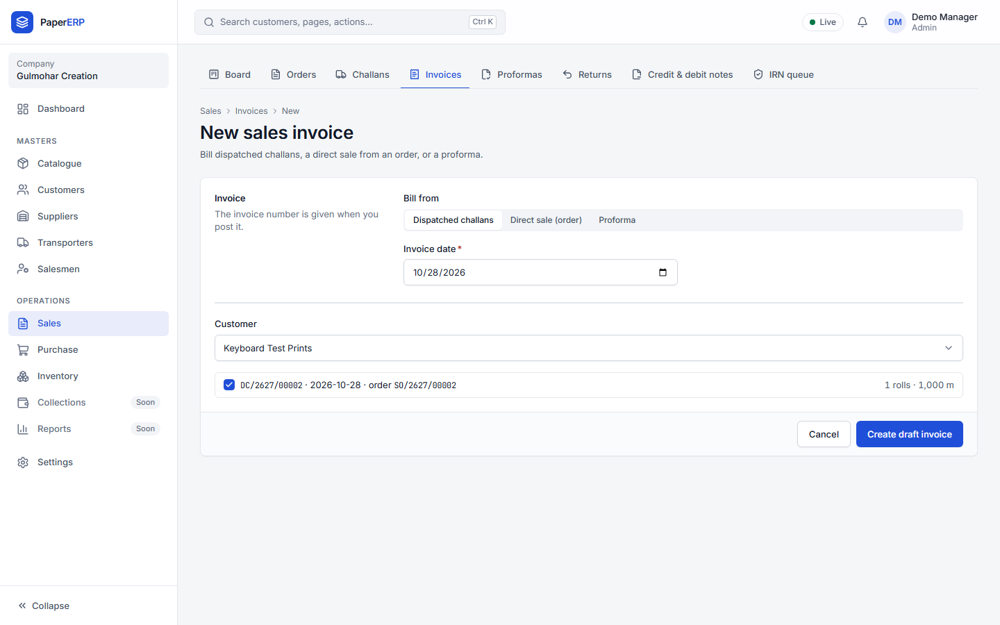
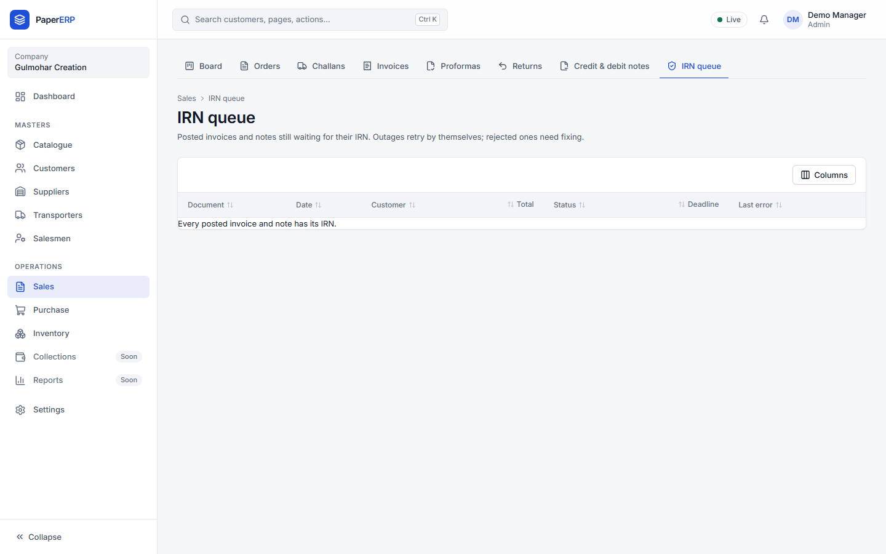
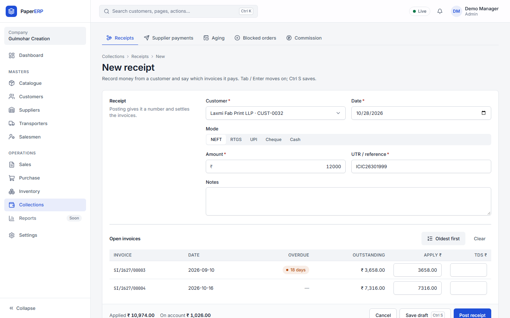
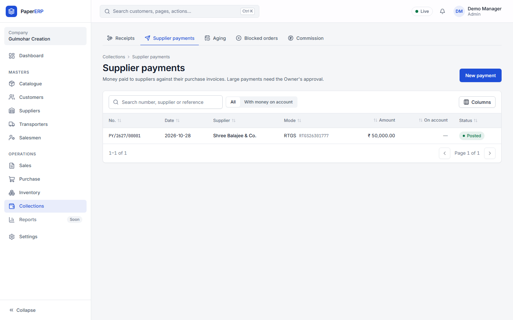
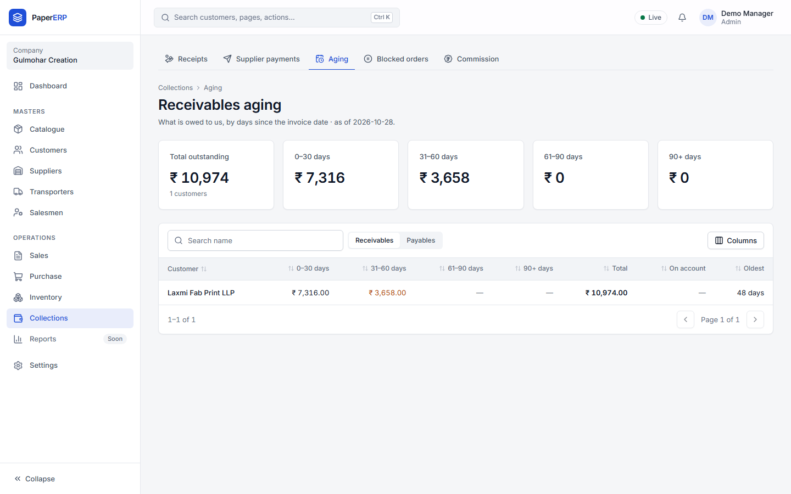
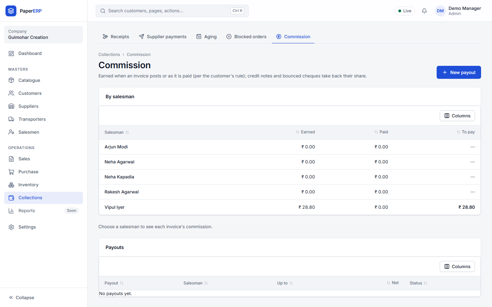
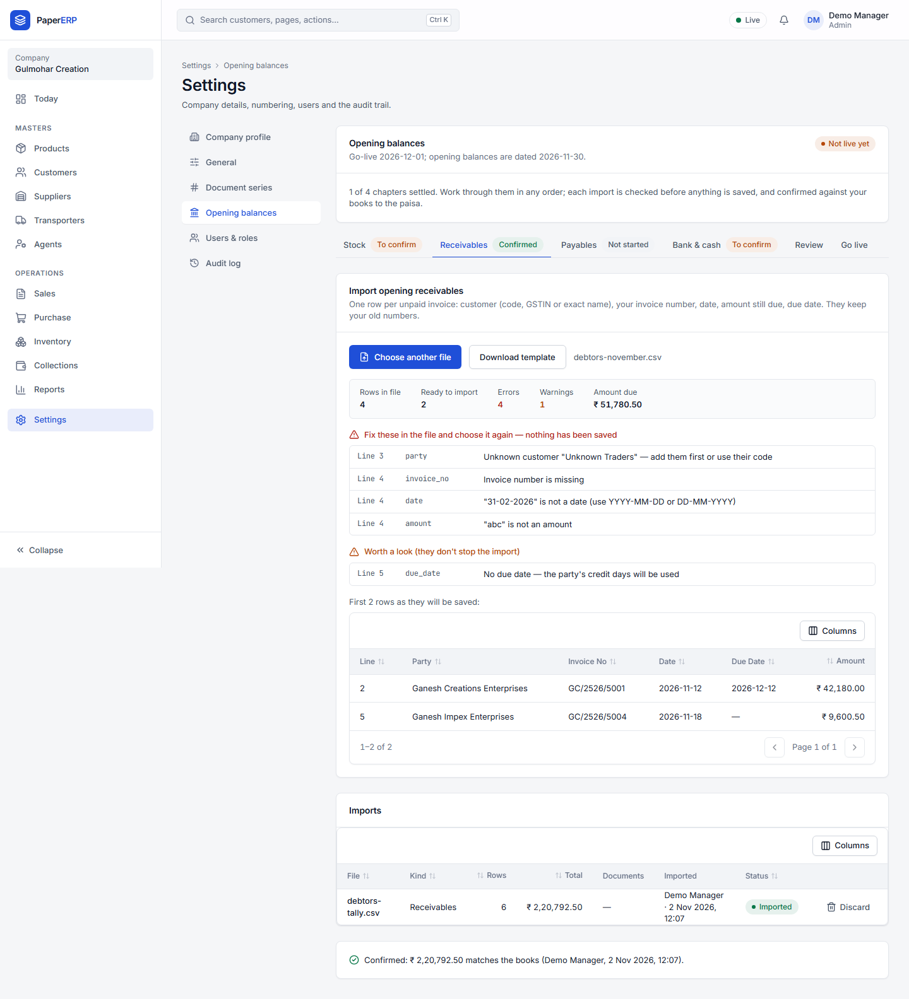
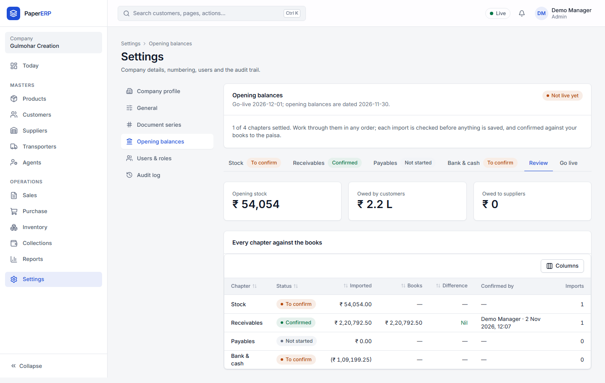

# Accounts guide

## Invoices and e-invoicing

1. **Sales → Invoices → New invoice**, pick the dispatched challan(s). Rates, discounts, HSN and the GST split come from the order.
2. **Post.** B2B invoices go to the IRN queue automatically.
   
3. **Sales → IRN** shows anything pending or rejected; fix the reason (e.g. a GSTIN) and retry.

Credit and debit notes: **Sales → Notes**. A credit note against an invoice reverses that invoice's commission automatically.

## Receipts

1. **Collections → Receipts → New receipt.** Customer, date, mode (NEFT, RTGS, UPI, cheque, cash), amount, UTR or cheque number.
2. **Oldest first** fills the amounts against the oldest invoices; change any amount. TDS the customer deducted goes in the TDS column.
3. Anything not applied stays **on account** and can be applied later from the customer's statement.
4. **Post.** Held orders are re-checked automatically.

A cheque that bounces: open the receipt → **Reverse / bounced**, with the reason (your password is asked).

## Supplier payments

The same as receipts, against purchase invoices. Payments above ₹5,00,000 need the Owner.

## Statements and aging

**Collections → Aging** shows who owes what by age; click a name for the statement (PDF to send).

## Commission

**Collections → Commission:** what each agent has earned; **New payout** for a month, then **Pay** with the reference and TDS.

## Opening balances (before go-live)

**Settings → Opening balances**, one chapter at a time, in any order:

1. **Download template**, fill it from the old books (Tally export or Excel, saved as CSV), **Choose CSV file**.
2. The file is checked first; nothing is saved. Fix any errors (shown by line) and choose the file again.
3. **Import.** You can **Discard** an import until go-live.
4. **Confirm** with the total from your books; it must match to the paisa.

- **Stock:** roll by roll (best: old barcodes are kept if valid) or totals per SKU.
- **Receivables / Payables:** one row per unpaid invoice; customers and suppliers must exist first.
- **Bank & cash:** one line per account; confirm each with your password.

**Review** shows every chapter against the books. Then the Owner goes live.
