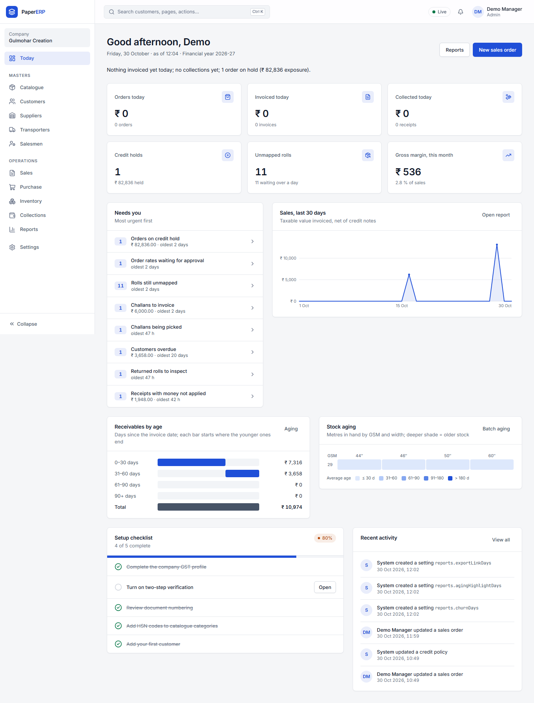
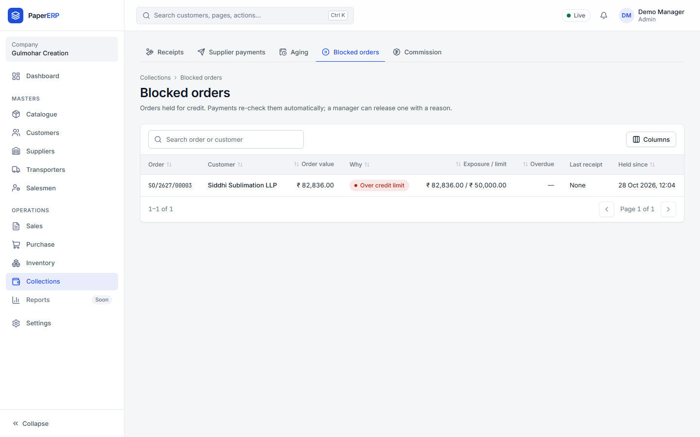
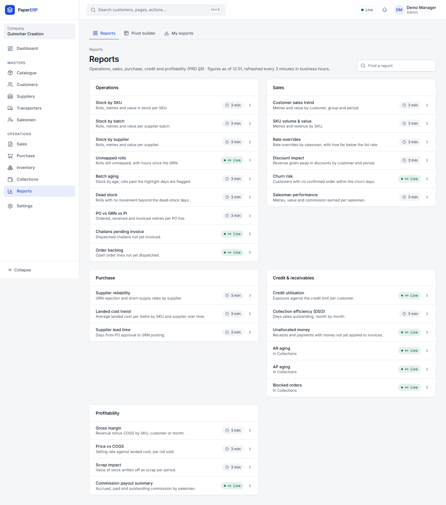
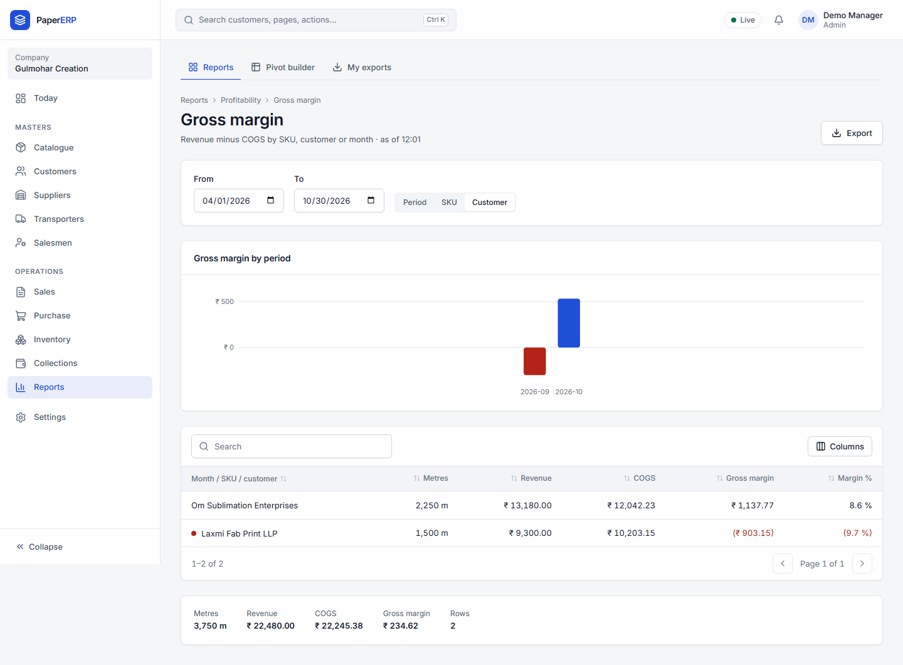
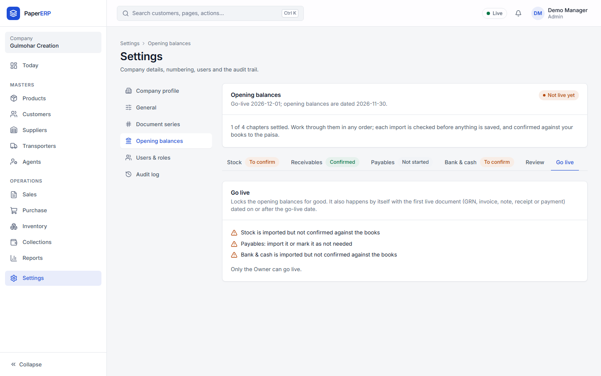

# Owner guide

## Start the day on Today

- The **sentence at the top** sums up the day: invoiced, collected, orders on hold.
- **KPI cards** (click any to open the list): orders, invoices and collections today, credit holds, unmapped rolls, gross margin this month.
- **Needs you** lists what is waiting, most urgent first. Click a row to deal with it:
  - *Order rates waiting for approval:* a rate below the allowed tolerance. Open the order, check the rate and approve (your password is asked).
  - *Orders on credit hold:* the customer is over the limit or overdue. Release with a reason if you agree.
  - *Supplier payments waiting for approval:* payments above ₹5,00,000 need you.
- The **charts** show sales for the last 30 days, receivables by age and stock age by GSM and width.

## Credit holds

**Collections → Blocked orders** shows each held order, why it is held, the customer's exposure and their last payment. **Release** asks for a reason and your password. Holds the system placed lift themselves once the customer pays.

## Reports

**Reports** lists every report by area. "Live" reports are up to the second; the others are at most 3 minutes old (press **Refresh now** if you need them this minute). Each report can be exported to Excel, CSV or PDF; the file appears under **My exports**.

**Gross margin** by month, SKU or customer is sales minus the landed cost of the rolls sold. Red rows lost money.

The **Pivot builder** answers anything else: pick rows (e.g. customer), columns (e.g. month) and what to show (metres, sales, margin). Save it and share it with a role.

## Going live

1. Set the go-live date: **Settings → General → Go-live**.
2. Accounts brings over the opening balances (see the [Accounts guide](accounts.md)).
3. When every chapter is confirmed, open **Settings → Opening balances → Go live**, type GO LIVE and confirm with your password. From then on the opening figures can't be changed, only corrected with a note or adjustment and a reason.

## Users

**Settings → Users & roles:** add people with the smallest role that fits their job. Deactivate people who leave; never share sign-ins.
