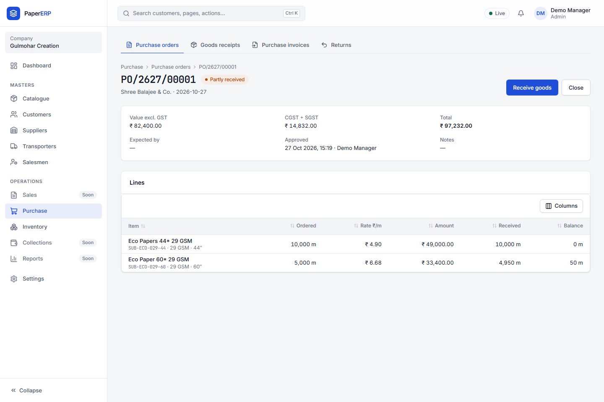
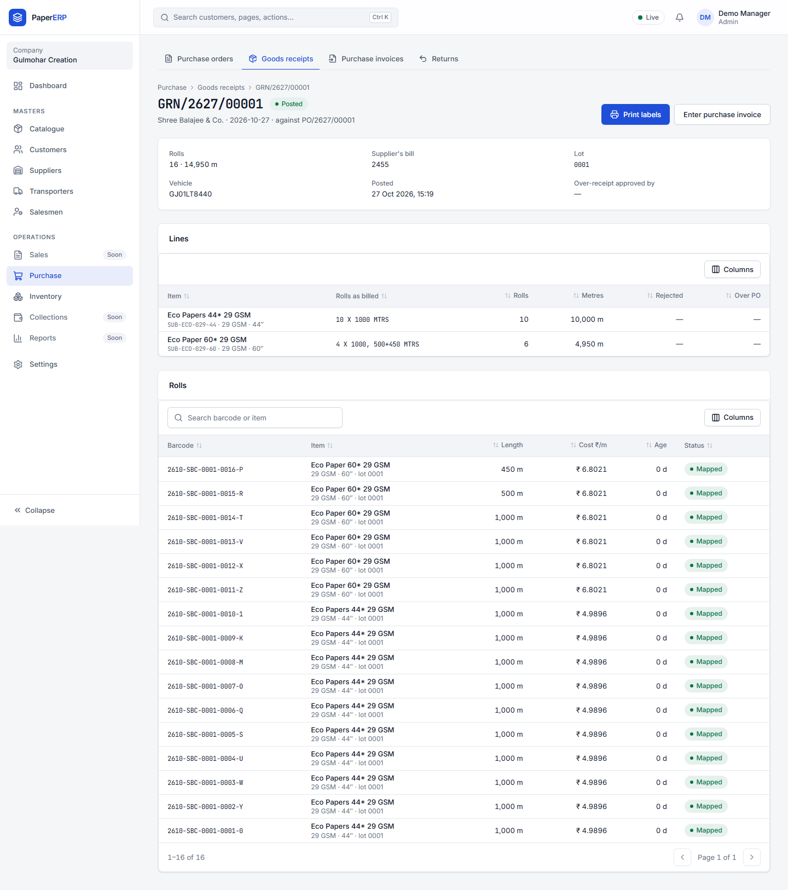
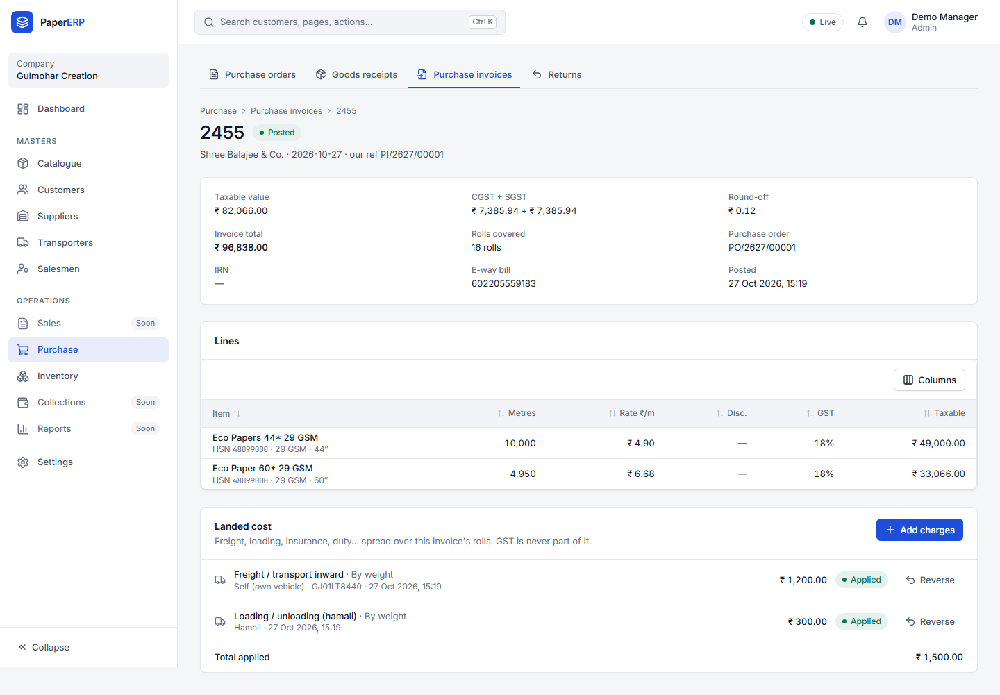
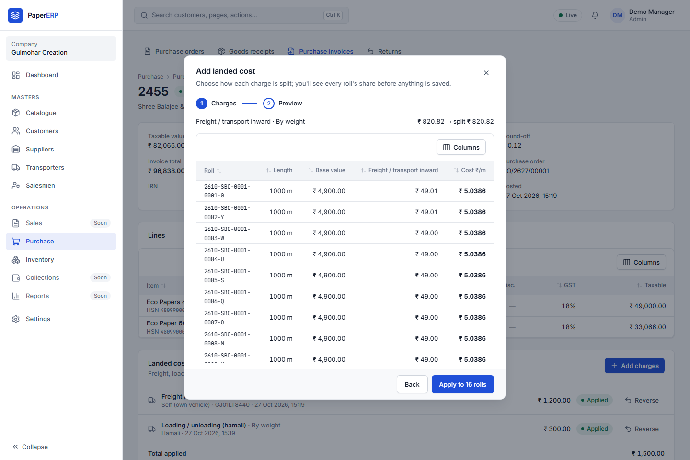

# Purchase guide

## Purchase orders

1. **Purchase → Orders → New purchase order.** Supplier, then a line per item: SKU, metres, rate per metre, GST.
2. **Approve.** The godown can now receive against it. The order tracks ordered, received and invoiced metres.

## Goods receipts

Usually done by the godown (see the [Warehouse guide](warehouse.md)). Receiving more than ordered beyond the tolerance needs your approval.

## Purchase invoices and landed cost

1. **Purchase → Invoices → New invoice:** the supplier's bill against the GRNs it covers.
2. Add freight, loading and other charges; choose how to spread them (by roll, metre, value or weight).
   
3. The preview shows each roll's landed cost before you post. **Post** fixes the cost of every roll; margins use it from then on.

## Returns to suppliers

**Purchase → Returns:** scan the rolls going back; posting issues the debit note.

## Reports for purchase

**Reports → Purchase:** supplier reliability (rejections, short supply), landed cost trend, supplier lead time; **PO vs GRN vs PI** under Operations shows what is still to come or to be billed.
