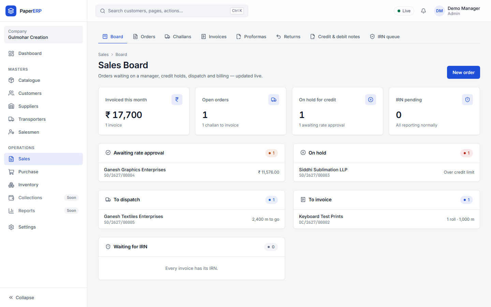
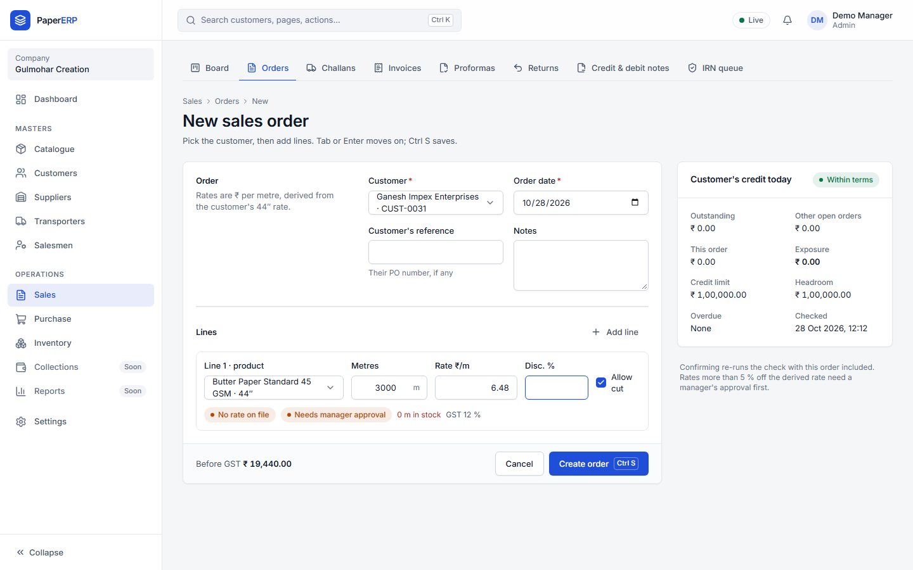
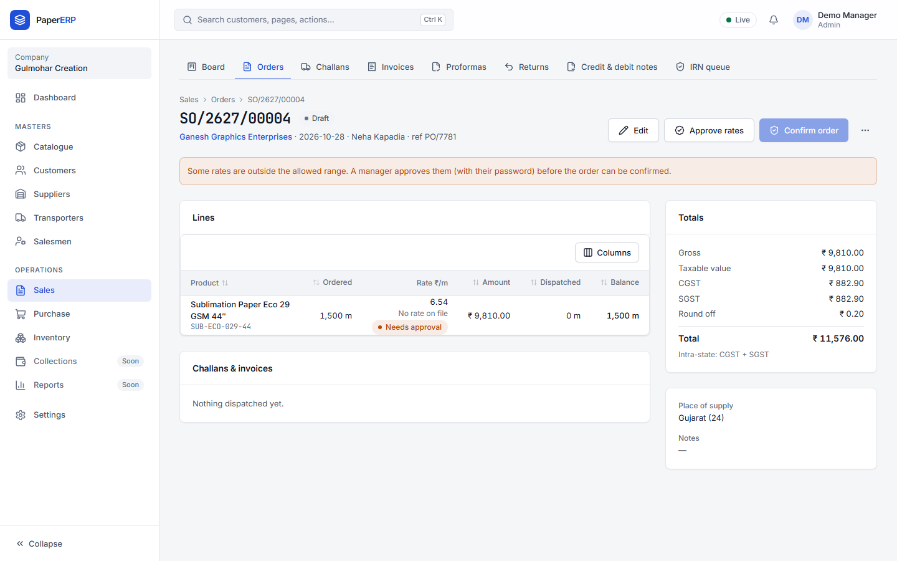
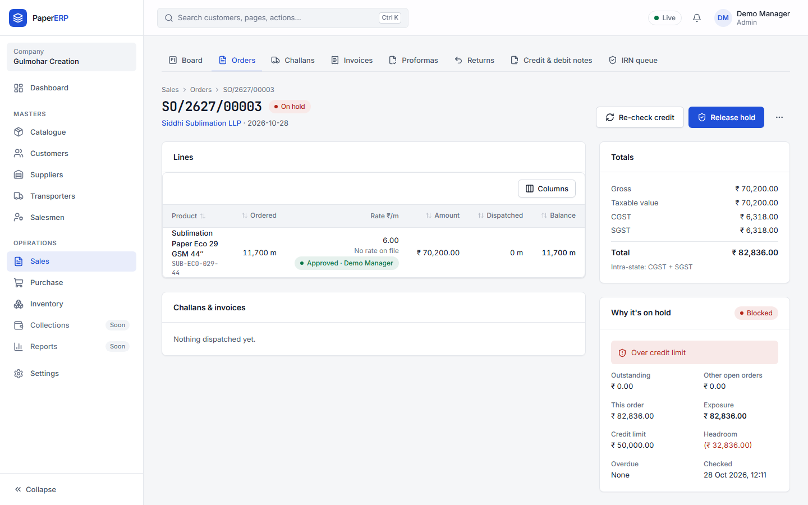
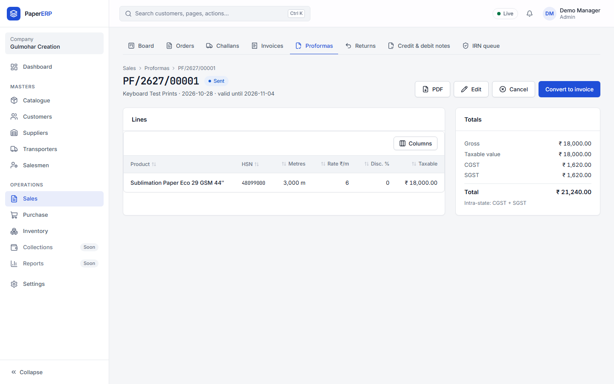
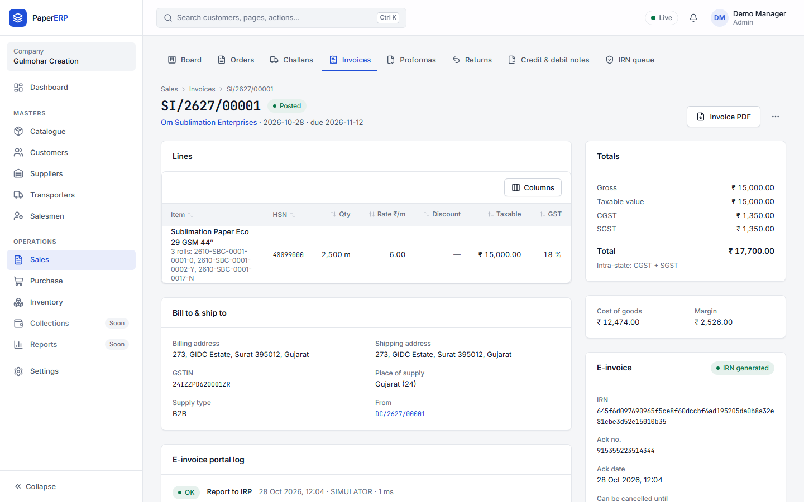
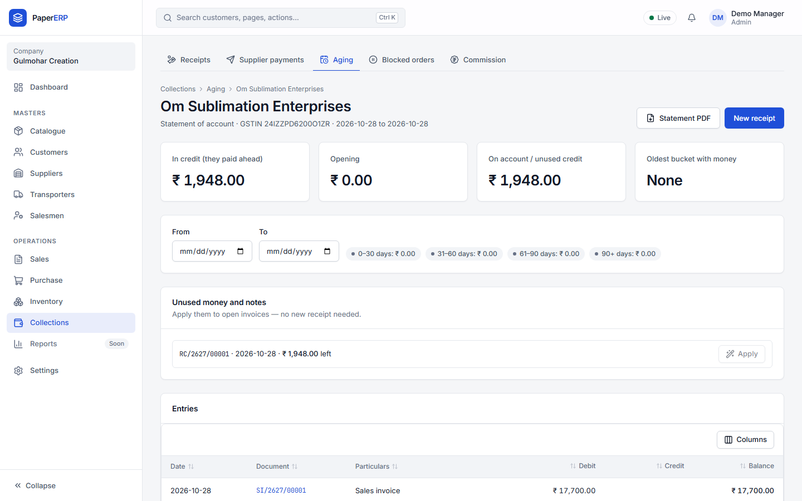

# Sales guide

## The Sales Board

Every open order by stage: Draft, On hold, Confirmed, Partly dispatched. Click a card to open the order.

## A new sales order

1. **Sales → Orders → New sales order.** Choose the customer.
2. For each line choose the SKU (GSM, quality, width) and enter the **metres**. The **rate per metre** fills in from the customer's rate at 44″, worked out for the width you chose.
3. Change the rate if you agreed a different one. Within the tolerance it is fine; below it the order **waits for the Owner's approval**.
   
4. **Confirm.** The credit check runs: if the customer is over the limit or overdue, the order goes **on hold** until it is released.
   

## Proformas

A proforma is a quotation the customer can pay against. **Send** it, then turn it into an invoice when the goods go.

## Invoices

Invoices are made by Accounts from the challan the godown dispatched. Registered (B2B) customers' invoices get their **IRN** and QR code automatically; the final PDF prints once the IRN is back.

## Your customers

**Customers →** open a customer to see their orders, invoices, payments, credit and rates. **Statement** shows what they owe, with aging. If you look after only some customers, you see only those.

## Reports for sales

**Reports → Sales:** sales trend by customer, SKU volume, rate overrides, discounts, churn risk (customers who stopped ordering), and salesman performance with commission.
