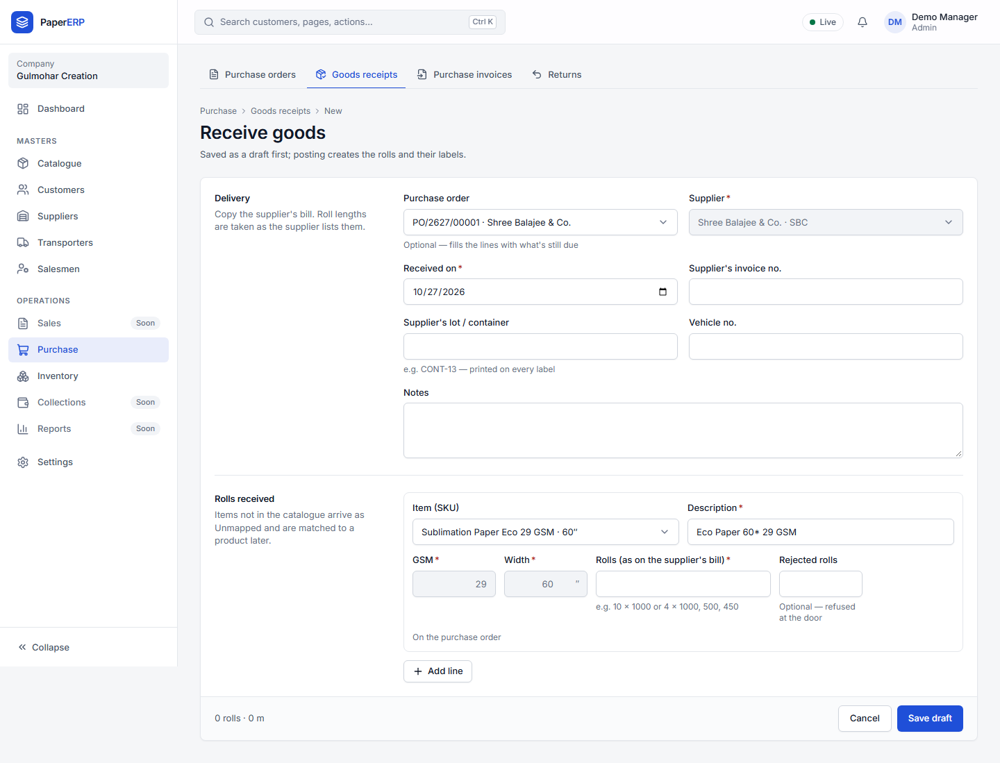
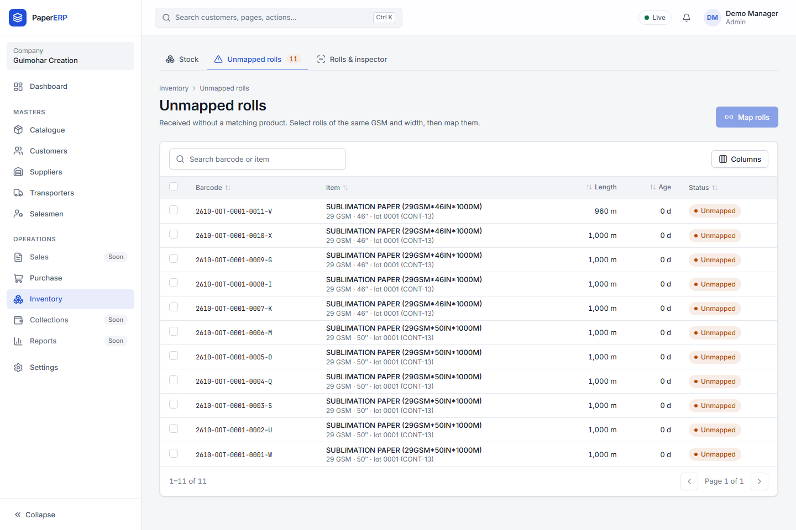
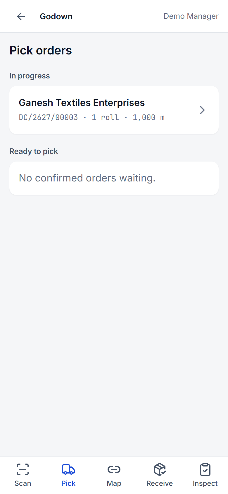
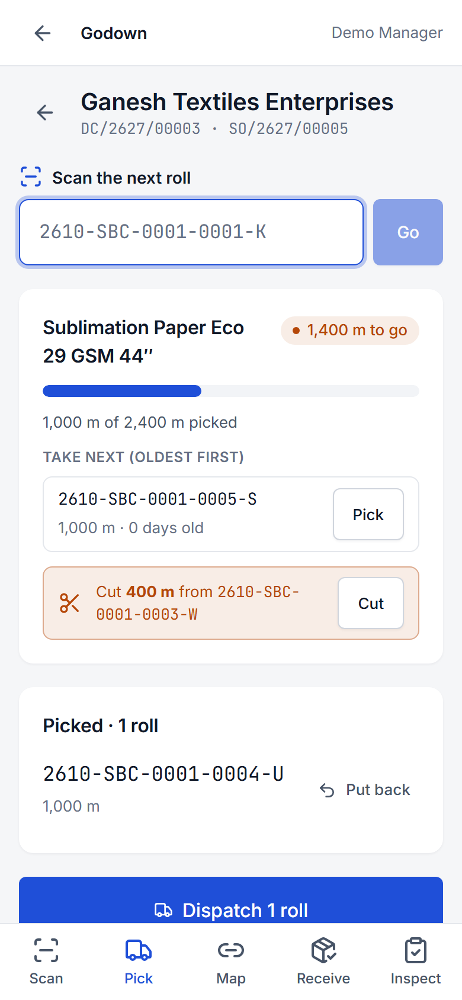
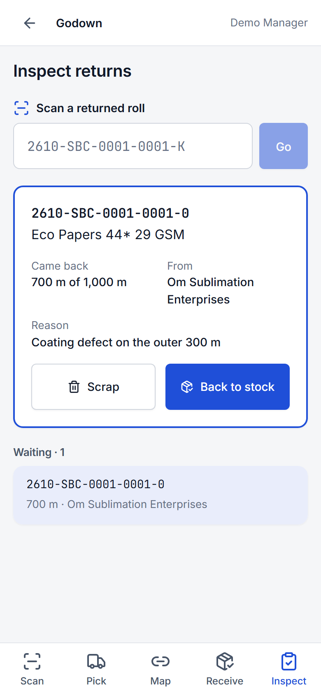
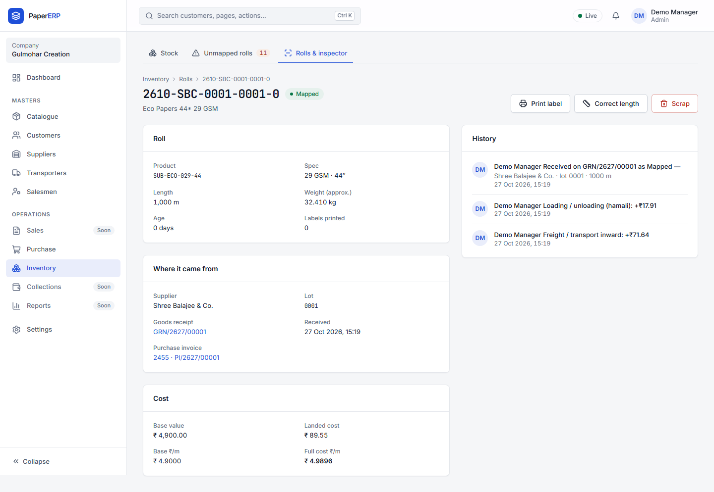

# Warehouse guide

Most godown work is on a phone at **/floor** (sign in once; it remembers you). Scan with the camera or a barcode gun.

## Receiving goods (GRN)

1. **Purchase → Goods receipts → Receive goods.** Choose the supplier and the purchase order.
2. For each line type the rolls as metres, e.g. `1000, 1000, 960` or `12 x 1000`. Rolls with damage go in **Rejected** with a reason.
3. **Post.** Every roll gets a barcode; print the labels and stick them on before the rolls move.

## Unmapped rolls

Rolls received without a catalogue item are **Unmapped**. **Inventory → Unmapped:** select the rolls, press **Map rolls**, choose the SKU. Rolls waiting more than a day turn orange on Today.

## Picking for a challan

1. Open **/floor → Pick**: the challans waiting for you.
2. Scan each roll you load. The screen suggests rolls (oldest first) but you can scan any roll of the right item.
   
3. **Cutting:** if the order needs part of a roll, enter the metres to cut. The cut piece gets a new barcode; reprint the parent roll's label with its new length.
4. When the challan is complete, the office posts it and makes the invoice.

## Returns

Returned rolls arrive as **Returned**. **/floor → Inspect:** scan, check, then **Back to stock** (at the length that came back) or **Scrap** with a reason. Pieces shorter than the minimum usable length are marked "Short".

## Roll Inspector

Scan any roll to see its whole story: supplier, batch, GRN, cost (if you may see it), order, challan, invoice, returns. Reprint a label, scrap a roll, or correct a length (with a reason) from here.
